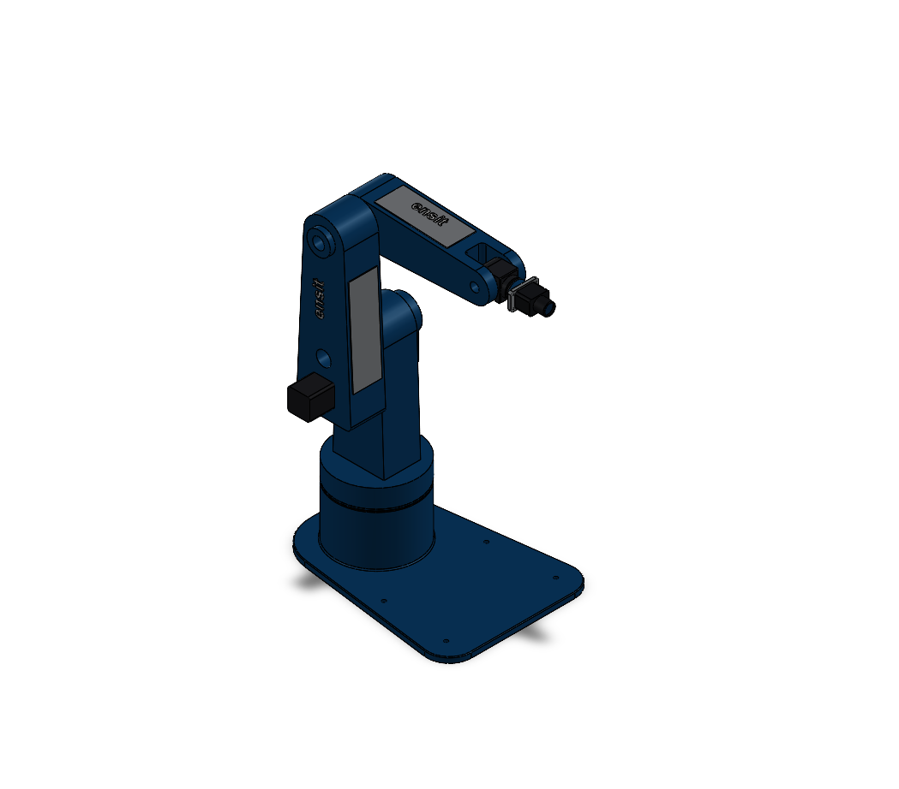
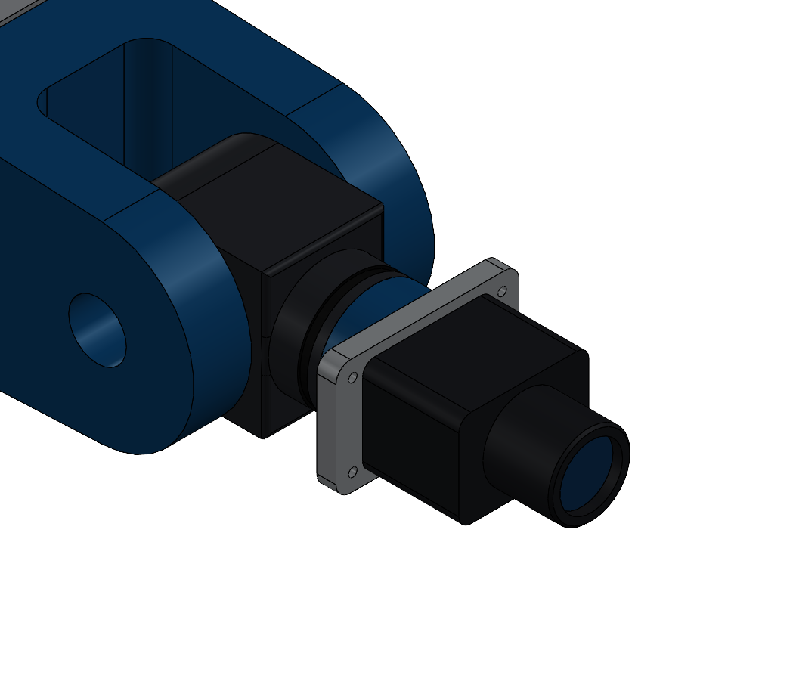
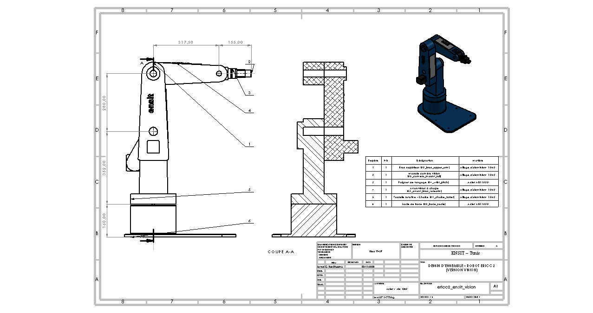

<div align="center">

# ERICC 2 — ENSIT Vision Edition

### 5-DOF Articulated Robotic Arm | SOLIDWORKS CAD & ROS 2 / Gazebo Digital Twin


-F58220?style=for-the-badge&logo=gazebo&logoColor=white)
-blue?style=for-the-badge)


*A complete CAD-to-Simulation Digital Twin of the classic **5-DOF ERICC 2** robotic manipulator, styled after **ENSIT** robotics lab hardware, retrofitted with a 2-axis articulated optical camera wrist (`J4` pitch + `J5` roll), and simulated in **ROS 2 Jazzy** and **Gazebo Harmonic**.*

<br>



</div>

---

## Overview

This repository contains the native **SOLIDWORKS** part models, articulated 5-DOF assembly, ISO A3 **Dessin d'ensemble**, and full **ROS 2 Jazzy / Gazebo Harmonic** physics simulation package for the **ERICC 2 (ENSIT Vision Edition)**. Built to nominal ERICC 2 link lengths and joint envelopes, the original mechanical gripper is replaced by a compact, balanced vision wrist carrying a simulated $640 \times 480$ RGB camera module.

| Parameter | Specification |
| :--- | :--- |
| **Designer** | Ghassen Ben Rhouma — École Nationale Supérieure d'Ingénieurs de Tunis (**ENSIT**) |
| **Credential Applied** | SOLIDWORKS Design Associate (**CSWA**) |
| **CAD Units & System** | `MMGS` (millimeter, gram, second) — converted to SI ($\text{m}$, $\text{kg}$, $\text{rad}$) for URDF |
| **Kinematic Chain** | 5-DOF Serial Manipulator (`RRR-RR`) |
| **Max Nominal Reach** | $752.50\text{ mm}$ from $O_2$ ($a_2 + a_3 + d_{\text{tool}}$) |
| **CAD Model Mass** | $147.75\text{ kg}$ (solid-body structural estimate) |
| **Assembly Validation** | Verified zero interferences (*Aucune interférence*) |
| **Simulation & Control** | ROS 2 Jazzy Jalisco, Gazebo Harmonic (`ogre2` PBR), `ros2_control`, `ros_gz_bridge` |

---

## Visual Showcase

| Side Elevation (*Vue de face*) | 2-Axis Vision Wrist Close-Up |
| :---: | :---: |
|  |  |

### ISO A3 Technical Drawing (*Dessin d'ensemble*)

Includes the front elevation, connected vertical section view (`COUPE A-A`) with alternating hatching, shaded isometric reference, official ERICC 2 kinematic dimensions, aligned underlined repères (`1`–`6`), and full French *Nomenclature* (BOM).



> **Printable Vector PDF:** [Download `ericc2_ensit_vision.pdf`](exports/ericc2_ensit_vision.pdf)

---

## Joint Hierarchy & Angular Limits

`00_base_socle` (`base_link`) is fixed at the origin. All 5 revolute joints use unlocked **Concentric** mates paired with flush **Coincident** (or centered **Width**) mates in SOLIDWORKS so the full manipulator exports cleanly and articulates under `ros2_control`.

| Joint | Variable | Parent $\rightarrow$ Child | Axis Ref | Min Angle | Max Angle | Total Stroke | Limits (Radians) | Motion Type |
| :---: | :---: | :--- | :---: | :---: | :---: | :---: | :---: | :--- |
| **J1** | $\theta_1$ | `00_base_socle` $\rightarrow$ `01_chaise_turret` | `Axis_J1` (Z) | $-135^\circ$ | $+135^\circ$ | $270^\circ$ | $[-2.356,\ +2.356]\text{ rad}$ | Base Pan |
| **J2** | $\theta_2$ | `01_chaise_turret` $\rightarrow$ `02_bras_upper_arm` | `Axis_J2` (Y) | $-90^\circ$ | $+43^\circ$ | $133^\circ$ | $[-1.571,\ +0.750]\text{ rad}$ | Shoulder Pitch |
| **J3** | $\theta_3$ | `02_bras_upper_arm` $\rightarrow$ `03_avant_bras_forearm` | `Axis_J3` (Y) | $-90^\circ$ | $+45^\circ$ | $135^\circ$ | $[-1.571,\ +0.785]\text{ rad}$ | Elbow Pitch |
| **J4** | $\theta_4$ | `03_avant_bras_forearm` $\rightarrow$ `04_wrist_pitch` | `Axis_J4` (Y) | $-90^\circ$ | $+90^\circ$ | $180^\circ$ | $[-1.571,\ +1.571]\text{ rad}$ | Wrist Pitch |
| **J5** | $\theta_5$ | `04_wrist_pitch` $\rightarrow$ `05_camera_mount_roll` | `Axis_J5` (X) | $-180^\circ$ | $+180^\circ$ | $360^\circ$ | $[-3.142,\ +3.142]\text{ rad}$ | Camera Roll |

<details>
<summary><b>SOLIDWORKS Tip: Applying Limit Angle Mates</b></summary>

Rotation is left unlocked by default so the assembly exports cleanly to URDF and Gazebo. To enforce mechanical stops while dragging the arm in SOLIDWORKS:
1. Open **Mate** $\rightarrow$ **Advanced Mates** $\rightarrow$ **Limit Angle**.
2. Select the reference planes of the parent and child links for the target joint.
3. Enter the **Min Angle** and **Max Angle** values from the table above.

</details>

---

## Bill of Materials & Kinematic Dimensions

| Repère | File Name (`cad/`) | Désignation | Material | Key Dimensions & Features |
| :---: | :--- | :--- | :--- | :--- |
| **6** | `00_base_socle.SLDPRT` | Socle de base | Acier AISI 1020 | Trapezoidal base plate ($15\text{ mm}$) + $\varnothing 220\text{ mm}$ pedestal; $160.00\text{ mm}$ height to $O_1$; ENSIT Blue (`RGB 15, 95, 165`) |
| **5** | `01_chaise_turret.SLDPRT` | Tourelle rotative - Chaise | Alliage d'aluminium 1060 | $\varnothing 220\text{ mm}$ drum + vertical column rising $352.00\text{ mm}$ to $O_2$; rear belt guard & drive motor |
| **1** | `02_bras_upper_arm.SLDPRT` | Bras supérieur | Alliage d'aluminium 1060 | Tapered boxy arm; $280.00\text{ mm}$ link length ($O_2 \rightarrow O_3$); side stepper motor, stainless cover plate & embossed `ensit` sign |
| **4** | `03_avant_bras_forearm.SLDPRT` | Avant-bras à chape | Alliage d'aluminium 1060 | Tapered forearm; $317.50\text{ mm}$ link length ($O_3 \rightarrow O_4$); $52.00\text{ mm}$ open clevis fork & stainless `ensit` top plate |
| **3** | `04_wrist_pitch.SLDPRT` | Poignet de tangage | Acier AISI 1020 | $50.00\text{ mm}$ pitch yoke ($1\text{ mm}$ clearance/side inside clevis); $65.00\text{ mm}$ offset to $\varnothing 48\text{ mm}$ roll boss |
| **2** | `05_camera_mount_roll.SLDPRT` | Module caméra vision | Alliage d'aluminium 1060 | $\varnothing 48\text{ mm}$ roll flange, universal adapter plate, $40\text{ mm}$ camera body & $\varnothing 34\text{ mm}$ lens ($90.00\text{ mm}$ length; $155.00\text{ mm}$ total reach from $O_4$) |

---

## Physics Digital Twin & ROS 2 Control

To transition from static CAD geometry to a dynamically faithful simulation in **ROS 2 Jazzy** and **Gazebo Harmonic**:

* **Exact SOLIDWORKS Inertial Tensors:** Mass, center of gravity (CoG), and all 6 inertia tensor components ($I_{xx}, I_{yy}, I_{zz}, I_{xy}, I_{xz}, I_{yz}$) were extracted directly from SOLIDWORKS (`cad/urdf_data.json`) and embedded in `urdf/` alongside viscous damping and Coulomb friction.
* **PBR Studio Rendering (`ogre2`):** Configured custom metallic shaders for anodized ENSIT Blue, brushed aluminum, and stainless steel accents under three-point studio lighting (`worlds/ericc2_world.sdf`).
* **Closed-Loop `ros2_control` & Vision Bridge:** Runs `joint_state_broadcaster` and a 5-DOF `JointTrajectoryController`, while `ros_gz_bridge` streams live $640 \times 480$ RGB images from the 5th-axis camera.

| ROS 2 Interface | Topic Name | Message Type | Direction | Description |
| :--- | :--- | :--- | :---: | :--- |
| **Trajectory Command** | `/arm_controller/joint_trajectory` | `trajectory_msgs/msg/JointTrajectory` | Sub | Smooth multi-axis position trajectory execution |
| **Joint Feedback** | `/joint_states` | `sensor_msgs/msg/JointState` | Pub | Real-time joint positions and velocities ($50\text{ Hz}$) |
| **RGB Camera Stream** | `/camera/image_raw` | `sensor_msgs/msg/Image` | Pub | Live $640 \times 480$ RGB frames from `camera_roll_link` |
| **Camera Intrinsics** | `/camera/camera_info` | `sensor_msgs/msg/CameraInfo` | Pub | Camera calibration matrix and distortion parameters |
| **Kinematic Tree** | `/tf` & `/tf_static` | `tf2_msgs/msg/TFMessage` | Pub | Real-time forward kinematic transforms |

### Quick Launch (ROS 2 Jazzy + Gazebo Harmonic)

```bash
# 1. Build and source the workspace
cd ~/ros2_ws
colcon build --packages-select ericc2_description
source install/setup.bash

# 2. Launch Gazebo Harmonic with ros2_control and the RGB camera bridge
ros2 launch ericc2_description gazebo.launch.py
```

Inspect the live 5th-axis camera stream or send a 5-DOF trajectory command from a second terminal:

```bash
# View live camera stream
ros2 run rqt_image_view rqt_image_view /camera/image_raw

# Command a 5-axis trajectory toward the workbench
ros2 topic pub --once /arm_controller/joint_trajectory trajectory_msgs/msg/JointTrajectory "{
  joint_names: ['joint_1', 'joint_2', 'joint_3', 'joint_4', 'joint_5'],
  points: [{
    positions: [0.0, 0.35, 0.25, 0.55, 0.0],
    time_from_start: {sec: 3, nanosec: 0}
  }]
}"
```

---

## Repository Structure

```text
ericc2-ensit-vision/
├── cad/
│   ├── 00_base_socle.SLDPRT
│   ├── 01_chaise_turret.SLDPRT
│   ├── 02_bras_upper_arm.SLDPRT
│   ├── 03_avant_bras_forearm.SLDPRT
│   ├── 04_wrist_pitch.SLDPRT
│   ├── 05_camera_mount_roll.SLDPRT
│   ├── ericc2_ensit_vision.SLDASM  # Full 5-DOF articulated assembly
│   ├── ericc2_ensit_vision.SLDDRW  # ISO A3 Dessin d'ensemble
│   └── urdf_data.json              # Extracted SOLIDWORKS mass & inertia tensors
├── config/                         # ros2_control YAML controller parameters
├── exports/
│   └── ericc2_ensit_vision.pdf     # Printable high-resolution A3 drawing
├── images/
│   ├── ericc2_hero.png
│   ├── ericc2_side_profile.png
│   ├── camera_wrist_closeup.png
│   └── ericc2_ensit_vision.JPG
├── launch/                         # ROS 2 Python launch files (gazebo.launch.py)
├── meshes/                         # Binary STL visual & collision meshes
├── urdf/                           # Modular URDF/Xacro description & Gazebo plugins
├── worlds/                         # Gazebo Harmonic SDF studio environment
├── CMakeLists.txt
├── package.xml
├── .gitignore
└── README.md
```

---

## Engineering Verification Checklist

- [x] All 6 part files built in `MMGS` units as single merged solid bodies (`Solid Bodies(1)`).
- [x] Explicit reference axes (`Axis_J1`–`Axis_J5`) and reference frames (`base_frame`, `camera_link`) included.
- [x] **Evaluate** $\rightarrow$ **Interference Detection** confirmed **Aucune interférence** (zero interferences).
- [x] ISO A3 technical drawing exported with connected section view (`COUPE A-A`), BOM, and ENSIT title block.
- [x] Full 6-component SOLIDWORKS inertia tensors, `ros2_control` trajectory execution, and `/camera/image_raw` bridge verified in ROS 2 Jazzy & Gazebo Harmonic.

---

## Author

**Ghassen Ben Rhouma**  
Master Professionnel Industrie 4.0 — **ENSIT** (Tunis, Tunisia)  
GitHub: [@ghassenbrh](https://github.com/ghassenbrh)